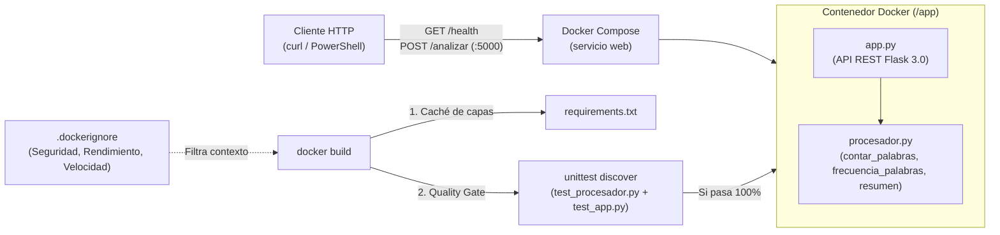
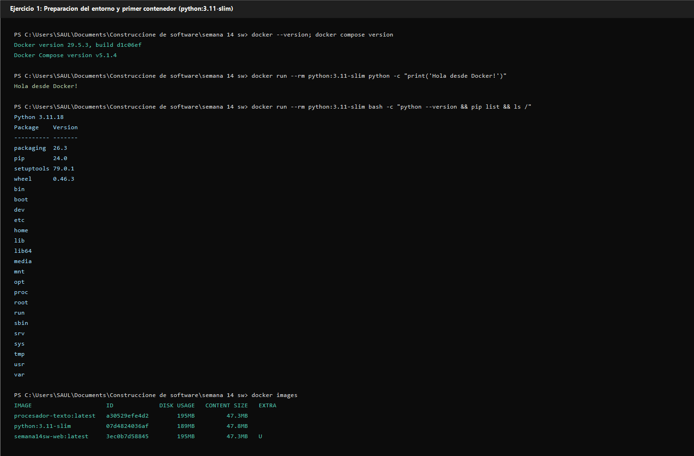
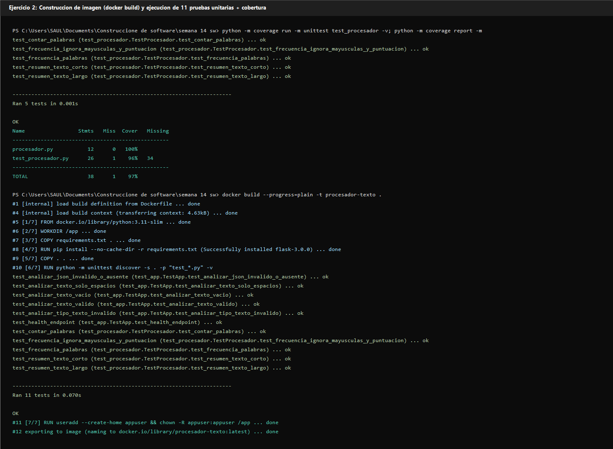
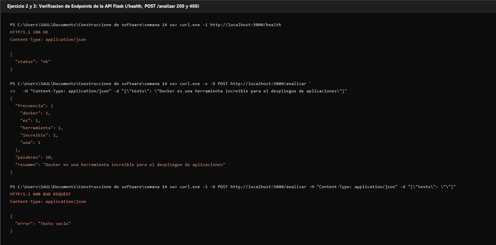
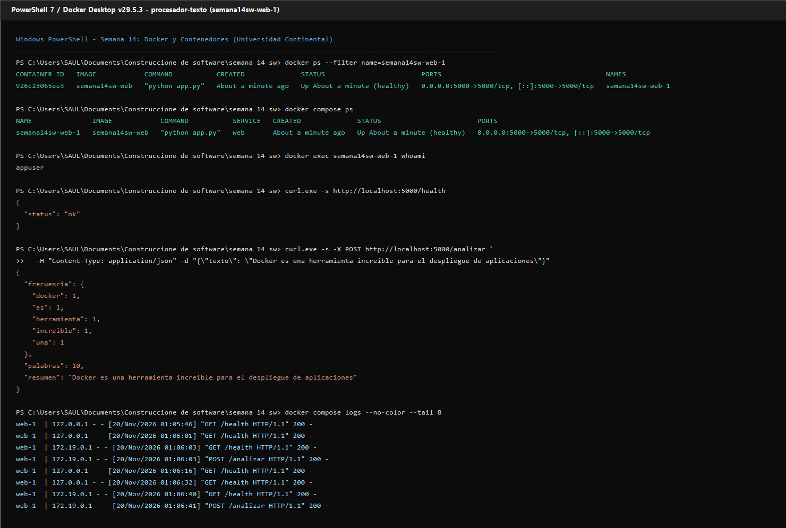

# Procesador de Texto con Flask y Docker — Semana 14

Práctica de **Unidad 4 · Semana 14: Docker y Contenedores para Despliegue Ágil**  
**Curso:** Construcción de Software · **Universidad Continental**  
**Docente:** Ing. Henderson Nozart Gibaja Reyes  

---

## 1. Contexto y Fundamento Teórico

El problema clásico *"en mi máquina funciona"* ocurre por diferencias de versión de Python, dependencias incompatibles, variables de entorno o configuraciones del sistema operativo entre desarrollo y producción.

**Docker** resuelve este problema empaquetando en un **contenedor** aislado y ligero:
- El runtime exacto (`Python 3.11-slim`).
- Las dependencias fijadas (`requirements.txt` → `flask==3.0.0`).
- El código fuente (`procesador.py`, `app.py`) y su suite de pruebas (`test_procesador.py`, `test_app.py`).
- Las variables de entorno (`ENV`) y configuración de red (`EXPOSE 5000`).

| Concepto | Rol en esta solución | Analogía POO |
| :--- | :--- | :--- |
| **Dockerfile** | Receta declarativa paso a paso para construir la imagen | Definición del código de una clase |
| **Imagen (`procesador-texto`)** | Plantilla inmutable de solo lectura con el entorno completo | **Clase** |
| **Contenedor (`mi-api` / `web`)** | Instancia ejecutable y aislada que comparte el kernel del host | **Instancia (Objeto)** |
| **Docker Compose** | Orquestador declarativo (`docker-compose.yml`) de servicios, puertos, volúmenes y healthchecks | Composición de servicios |

---

## 2. Arquitectura del Sistema



### Estructura del proyecto

```text
.
├── app.py                            # API REST Flask (GET /health y POST /analizar)
├── procesador.py                     # Módulo NLP (conteo, frecuencia top-N y resumen)
├── test_procesador.py                # Pruebas unitarias del módulo procesador (100 % cobertura)
├── test_app.py                       # Pruebas de integración de los endpoints Flask
├── requirements.txt                  # Dependencias Python fijadas (flask==3.0.0)
├── Dockerfile                        # Construcción multicapa con tests en build y usuario no-root
├── .dockerignore                     # Exclusiones del contexto de build
├── docker-compose.yml                # Orquestación del servicio web + healthcheck
├── .gitignore                        # Exclusiones de control de versiones Git
├── evidencias/
│   ├── 01_ejercicio1_primer_contenedor.png
│   ├── 02_ejercicio2_docker_build_tests.png
│   ├── 03_ejercicio2_api_endpoints.png
│   └── captura_docker_api.png        # Evidencia de docker ps, Compose y respuestas de la API
└── README.md                         # Documentación de arquitectura e instrucciones
```

---

## 3. Buenas Prácticas de Docker Aplicadas

1. **Imagen oficial y ligera (`python:3.11-slim`):** Reduce cientos de MB frente a la imagen completa `python:3.11`, disminuyendo la superficie de ataque y acelerando descargas.
2. **Aprovechamiento de la caché de capas:** Se ejecuta `COPY requirements.txt .` y `RUN pip install ...` **antes** de `COPY . .`. Así, al modificar el código fuente, Docker reutiliza la capa cacheada de dependencias sin reinstalar Flask.
3. **Sin secretos en la imagen y uso de `ENV`:** Se configuran variables no sensibles (`PYTHONDONTWRITEBYTECODE=1`, `PYTHONUNBUFFERED=1`, `PORT=5000`) y se bloquea `.env` tanto en `.dockerignore` como en `.gitignore`.
4. **Un proceso por contenedor:** El contenedor ejecuta exclusivamente el servicio web Flask, orquestado mediante `docker-compose.yml`.
5. **Pruebas automatizadas durante el build (*Quality Gate*):** La instrucción `RUN python -m unittest discover -s . -p "test_*.py" -v` ejecuta todas las pruebas unitarias y de API al construir la imagen. Si algún test falla, la imagen **no se construye**.
6. **Ejecución con usuario no-root (`appuser`):** Siguiendo las buenas prácticas de seguridad en producción, el contenedor crea y utiliza el usuario sin privilegios `appuser` (`USER appuser`).
7. **`.dockerignore` optimizado (Seguridad, Rendimiento y Velocidad):** Excluye `.env`, `.git/`, `__pycache__/`, `venv/` y documentación pesada para enviar un contexto mínimo al daemon de Docker, manteniendo `test_*.py` disponibles para la validación en tiempo de build.
8. **Compatibilidad con Flask 3.0 (`FLASK_DEBUG=1`):** En `docker-compose.yml` se utiliza `FLASK_DEBUG=1` (que reemplaza al deprecado `FLASK_ENV=development` en Flask 3.0) junto con un `healthcheck` nativo contra `GET /health`.

---

## 4. Instrucciones de Uso

### Requisitos previos
- [Docker Desktop](https://www.docker.com/products/docker-desktop/) instalado y en ejecución (`docker --version` y `docker compose version`).

### Ejercicio 1: Contenedor efímero de verificación

```bash
docker run --rm python:3.11-slim python -c "print('Hola desde Docker!')"
```

### Ejercicio 2: Construcción y ejecución con Docker CLI

1. **Construir la imagen** (ejecuta automáticamente los 11 tests durante el build):
   ```bash
   docker build --progress=plain -t procesador-texto .
   ```

2. **Ejecutar el contenedor en segundo plano**:
   ```bash
   docker run -d -p 5000:5000 --name mi-api procesador-texto
   ```

3. **Verificar contenedor, usuario no-root y logs**:
   ```bash
   docker ps
   docker exec mi-api whoami
   docker logs mi-api
   ```

4. **Detener y eliminar el contenedor**:
   ```bash
   docker stop mi-api && docker rm mi-api
   ```

### Ejercicio 3: Orquestación con Docker Compose

```bash
# Construir e iniciar en segundo plano
docker compose up -d --build

# Verificar estado de los servicios (incluye estado healthy)
docker compose ps
docker ps

# Consultar logs en tiempo real
docker compose logs -f

# Detener y limpiar contenedores y red
docker compose down
```

---

## 5. Pruebas de la API REST

### Endpoint de salud (`GET /health`)

```bash
curl http://localhost:5000/health
```

Respuesta:
```json
{"status": "ok"}
```

### Endpoint de análisis de texto (`POST /analizar`)

**En Bash / Linux / macOS:**
```bash
curl -X POST http://localhost:5000/analizar \
  -H "Content-Type: application/json" \
  -d '{"texto": "Docker es una herramienta increible para el despliegue de aplicaciones"}'
```

**En PowerShell (Windows):**
```powershell
Invoke-RestMethod -Uri http://localhost:5000/analizar `
  -Method Post `
  -ContentType "application/json" `
  -Body '{"texto": "Docker es una herramienta increible para el despliegue de aplicaciones"}' | ConvertTo-Json -Depth 4
```

Respuesta esperada (`HTTP 200 OK`):
```json
{
  "frecuencia": {
    "docker": 1,
    "es": 1,
    "una": 1,
    "herramienta": 1,
    "increible": 1
  },
  "palabras": 10,
  "resumen": "Docker es una herramienta increible para el despliegue de aplicaciones"
}
```

### Validación de manejo de errores (`HTTP 400 Bad Request`)

```powershell
Invoke-RestMethod -Uri http://localhost:5000/analizar -Method Post -ContentType "application/json" -Body '{"texto": ""}'
```

Respuesta (`HTTP 400`):
```json
{"error": "Texto vacio"}
```

---

## 6. Ejecución de Pruebas Unitarias y Cobertura Local

```bash
python -m unittest discover -s . -p "test_*.py" -v
python -m coverage run -m unittest test_procesador -v
python -m coverage report -m
```

---

## 7. Evidencias de Funcionamiento por Ejercicio

### 7.1 Ejercicio 1: Preparación del entorno y primer contenedor (`python:3.11-slim`)


### 7.2 Ejercicio 2: Construcción de imagen (`docker build`), pruebas unitarias (11 tests) y cobertura (100 %)


### 7.3 Ejercicio 2 y 3: Verificación de endpoints (`GET /health`, `POST /analizar` 200 OK y 400 Bad Request)


### 7.4 Ejercicio 3: Orquestación con Docker Compose (`docker ps`, `docker compose ps`, usuario `appuser` y logs)

